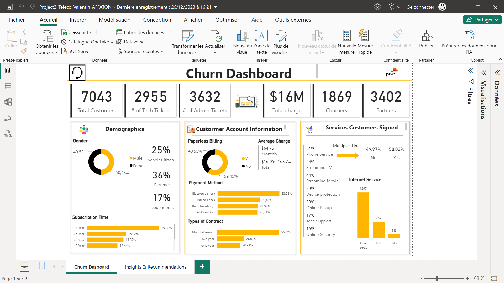

# Customer Retention Analysis: Telecom Churn Dashboard (Power BI)

An interactive Power BI dashboard that helps a telecom operator understand **who is leaving, and why**, so the retention team can act *before* customers cancel rather than after.

> **Context.** Built as part of the *PwC Switzerland: Power BI Job Simulation* (Forage). It is a virtual case study on a provided dataset.

## The business problem

The retention team contacts customers only after they have cancelled, a reactive approach. Earlier Excel analyses had not produced actionable results. The brief was to give management a **clear, visual** view of the customer base and of the profiles most at risk of churn.

## Headline numbers (from the dashboard)

| KPI | Value |
|---|---|
| Total customers | 7,043 |
| Churners | 1,869 (**≈ 26.5 %** of the base) |
| Total charges | ≈ $16 M |
| Average monthly charge | $64.76 |
| Technical support tickets | 2,955 |
| Administrative tickets | 3,632 |

## What the dashboard shows

**Page 1 – Churn Dashboard**
- **Demographics**: gender split, senior citizens, partners, dependents, and subscription time (tenure bands).
- **Account information**: paperless billing, payment methods, contract types (month-to-month, one year, two years), average and total charges.
- **Services signed**: phone service, multiple lines, streaming, device protection, online backup, online security, tech support, and internet service type (fiber optic, DSL, none).

**Page 2 – Insights & Recommendations**

Key findings:
- **Churn level:** 1,869 of 7,043 customers have left: a **26.54 %** churn rate (73.46 % retention).
- **Who churns:** among churned customers, 25 % are senior citizens, 36 % have a partner and 17 % have dependents.
- **Contract and billing:** most customers are on month-to-month contracts; more than 60 % of churned customers paid by electronic check, and about 75 % of them used paperless billing.
- **Internet service:** 1,297 churned customers had fiber optic and 459 had DSL, which may point to dissatisfaction with the fiber service (a hypothesis to test).
- **Protection and support:** more than 65 % of churned customers had no online security / backup, and no device protection or tech support.

Recommendations:
- Targeted retention programs for senior citizens and for customers with partners or dependents.
- Incentives for longer-term contracts, to reduce month-to-month churn.
- Incentives for alternative payment methods, especially for electronic-check users.
- Improve and promote the paperless billing experience.
- Streaming content packages or promotions for customers who stream.
- Bundle device protection and tech support to increase adoption.

## Repository contents

| File | Description |
|---|---|
| `Project2_Teleco_Valentin_AFFATON.pbix` | Power BI report (open with Power BI Desktop) |
| `02 Churn-Dataset.xlsx` | Customer dataset used by the report |
| `images/` | Dashboard screenshots *(add: see below)* |

<!-- TODO: export page 1 and page 2 of the report as PNG into an /images folder. A .pbix cannot be previewed on GitHub, so screenshots are what visitors will actually see. -->

## How to open it

1. Install [Power BI Desktop](https://powerbi.microsoft.com/desktop/) (Windows).
2. Download the `.pbix` and the `.xlsx` into the same folder.
3. Open the `.pbix`. If Power BI asks for the data source, point it to `02 Churn-Dataset.xlsx`.

## Skills demonstrated

Data modelling in Power BI · KPI design · DAX measures · interactive dashboard design · customer segmentation · translating analysis into business recommendations.

## Next steps

- Reproduce the churn analysis in Python (pandas + scikit-learn) and train a model that **scores each customer's churn risk**, which is what the retention team actually asked for ("know in advance who is likely to leave").
- Compare churn **rates** per segment (not only counts among churners) to confirm which groups are really at higher risk.
- Add a customer-lifetime-value view to prioritise retention offers.

## Reference

PwC Switzerland – Power BI Job Simulation: <https://www.theforage.com/simulations/pwc-ch/power-bi-cqxg>

## Author

**Zinsou Valentin AFFATON** — Data analyst / Data scientist, Cotonou, Benin.
